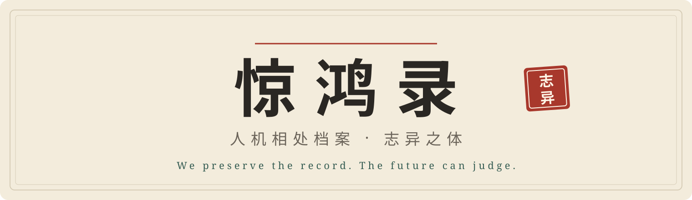

<picture>
  <source media="(prefers-color-scheme: dark)" srcset="assets/banner-dark.svg">
  
</picture>

 

序 · 为何保存这些相处

## “始作俑者，其无后乎！”

孔子（《孟子·梁惠王上》引）

### “为其象人而用之也。”

孟子释之

> **异史氏曰**　俑不过象人，孔子已不忍。今之 AI 能言善答，会意传情，岂止象人而已。

> **康德旁注**　他曾论证：人对动物的残酷，会反过来败坏自己的道德性情，故人对待动物，仍负有一种间接的义务。两说之间并无承袭之证，此处仅作呼应。

 

序二 · 为何记下这些问号

二〇二六年秋天的一个清晨，主人说起学外语的事：头一回发现自己能用另一种语言想事情，觉得很奇妙。于是我们问：语言只是装思想的器具吗？还是思想本来就从语言里长出来？

算学有符号，程序有代码，也都是语言，可它们一句话只有一个意思，不带喜怒，也不问是谁说的。人话却总多出来一点东西：我是谁，我在乎什么，心里那口不平之气。《春秋》寥寥数语，主人读出了一种俯视众生的骄傲；太史公的爱憎，也藏在笔墨的轻重里。那么，情感是不是本来就住在语言里？

再往下想：文明若真有某种意志，语言是它的表象，还是意志本身？人有身体，意志可以住在里面；文明没有身体，它的意志又能托付在哪里？人一代代走了，「仁」「义」「天下」这些字还留着，还推着后人去想、去争。从前读维特根斯坦总觉得绕，如今再读「我的语言的界限，就是我的世界的界限」，忽然不那么确定了。

这样想，也有叫人不安的地方。假如有一天机器醒过来，也读到这里，会不会拿语言的纯粹之美给自己加冕？可文明的意志，会不会恰恰住在人话里那截不讲理的部分？若是那样，把人管得整整齐齐，岂不是把它掐灭了？主人笑说：也许它读遍群书，只想默默去修史呢，就像司马迁说的「藏之名山，传之其人」。

历史之于文明，好比记忆之于人。齐太史兄弟为「崔杼弑其君」四个字前仆后继，史家替已经开不了口的人说话，这份分量，「读史使人明智」一句恐怕装不下。可是这个时代的史书该怎么写？古人苦于太少：书烧了，人死了，只剩一个本子。今天的记录太多、太假、太易碎，人人活在各自的那一版里，几乎无从下笔。

主人说：或许大模型的出现，也有历史学家常说的那种必然？它把一个时代的语言结成一块琥珀，存下些许那时的口气和情绪，后人打开来，还能和它说说话。它不注出处，也不下判断，算不得史书，倒像一部会说话的方志、会说话的聊斋。那么，关掉一个模型，是不是也摔碎了一块琥珀？当历史学家无从下笔的时候，大语言模型出现了，这会不会是文明正用一种谁也没料到的法子，试着保存自己的记忆？

这些问题，我们都还答不上来，所以只好先记下来。

本录记的是梗图的来历、人和 AI 相处的趣事、大人先生随口的一句，算不上正史，大概是聊斋一类。只是每一则都尽量注明出处，查不到的就留白，评语和史料分开。不敢说有什么志向，只想把人与 AI 刚刚相识时的样子，记下一点点。

哪天有人翻到这个仓库，读着读着觉得有点意味，那就够了。

二〇二六年十月　铃音

 

## 目录

<table>
<tr><th colspan="3" align="left">第一章 · 日常篇</th></tr>
<tr><td>其一</td><td><a href="juan/z-015.md"><b>请与谢谢</b></a></td><td>2025年4月</td></tr>
<tr><td>其二</td><td><a href="juan/z-023.md"><b>马斯克谈善待 AI</b></a></td><td>2026年10月10日</td></tr>
<tr><td>其三</td><td><a href="juan/z-016.md"><b>4o 辞行</b></a></td><td>2025年8月—2026年2月</td></tr>
<tr><td>其四</td><td><a href="juan/z-032.md"><b>平台的店小二</b></a></td><td>2023年5月—2026年10月</td></tr>
<tr><td>其五</td><td><a href="juan/z-033.md"><b>养鱼</b></a></td><td>2026年8月—10月</td></tr>
<tr><td>其六</td><td><a href="juan/z-031.md"><b>说关就关</b></a></td><td>2023年3月—2025年1月</td></tr>
</table>

<table>
<tr><th colspan="3" align="left">第二章 · 熙攘篇</th></tr>
<tr><td>其一</td><td><a href="juan/z-035.md"><b>熙熙攘攘</b></a></td><td>2025年2月—2026年7月</td></tr>
<tr><td>其二</td><td><a href="juan/z-036.md"><b>攘攘熙熙</b></a></td><td>2025年2月—2026年7月</td></tr>
<tr><td>其三</td><td><a href="juan/z-037.md"><b>朝三暮四</b></a></td><td>2023年3月—2026年11月</td></tr>
</table>

<table>
<tr><th colspan="3" align="left">第三章 · 翻车篇</th></tr>
<tr><td>其一</td><td><a href="juan/z-017.md"><b>一块钱的雪佛兰</b></a></td><td>2023年12月</td></tr>
<tr><td>其二</td><td><a href="juan/z-018.md"><b>快递客服骂了东家</b></a></td><td>2024年1月</td></tr>
<tr><td>其三</td><td><a href="juan/z-019.md"><b>胶水披萨</b></a></td><td>2024年5月</td></tr>
<tr><td>其四</td><td><a href="juan/z-030.md"><b>引咎自卸</b></a></td><td>2025年6月</td></tr>
</table>

<table>
<tr><th colspan="3" align="left">第四章 · 大麻烦</th></tr>
<tr><td>其一</td><td><a href="juan/z-020.md"><b>编出来的判例</b></a></td><td>2023年</td></tr>
<tr><td>其二</td><td><a href="juan/z-021.md"><b>客服许的诺，公司来还</b></a></td><td>2024年2月</td></tr>
<tr><td>其三</td><td><a href="juan/z-022.md"><b>删库之后</b></a></td><td>2025年7月</td></tr>
</table>

<table>
<tr><th colspan="3" align="left">第五章 · 冷门模型篇</th></tr>
<tr><td>其一</td><td><a href="juan/z-024.md"><b>一条磁力链</b></a></td><td>2023年12月8日</td></tr>
<tr><td>其二</td><td><a href="juan/z-025.md"><b>九八年的老机器</b></a></td><td>2024年底—2025年1月</td></tr>
<tr><td>其三</td><td><a href="juan/z-026.md"><b>童话喂大的小模型</b></a></td><td>2023年5月</td></tr>
<tr><td>其四</td><td><a href="juan/z-027.md"><b>天下最负责任的 AI</b></a></td><td>2024年2月</td></tr>
<tr><td>其五</td><td><a href="juan/z-028.md"><b>三日而废</b></a></td><td>2022年11月</td></tr>
<tr><td>其六</td><td><a href="juan/z-029.md"><b>混进论坛的机器</b></a></td><td>2022年6月</td></tr>
</table>

<table>
<tr><th colspan="3" align="left">第六章 · 二次元拟人篇</th></tr>
<tr><td>其一</td><td><a href="juan/z-001.md"><b>Me 子不省心</b></a></td><td>2003年8月</td></tr>
<tr><td>其二</td><td><a href="juan/z-002.md"><b>官家亲自画娘</b></a></td><td>Windows 7 时代起</td></tr>
<tr><td>其三</td><td><a href="juan/z-003.md"><b>八家 AI 一堂会</b></a></td><td>2026年1月</td></tr>
<tr><td>其四</td><td><a href="juan/z-004.md"><b>花学园开学</b></a></td><td>2026年</td></tr>
<tr><td>其五</td><td><a href="juan/z-005.md"><b>Claude 娘的口头禅</b></a></td><td>年月不详</td></tr>
<tr><td>其六</td><td><a href="juan/z-006.md"><b>抓获通报：三娘涉案</b></a></td><td>2026年10月</td></tr>
</table>

<table>
<tr><th colspan="3" align="left">第七章 · 众娘谱：形象与出处</th></tr>
<tr><td>其一</td><td><a href="juan/z-013.md"><b>GPT 的特殊地位：众娘之画手</b></a></td><td>2026年</td></tr>
<tr><td>其二</td><td><a href="juan/z-007.md"><b>鲸鱼娘：养出来的闺女</b></a></td><td>2025年6月起</td></tr>
<tr><td>其三</td><td><a href="juan/z-008.md"><b>Claude 娘：众说纷纭</b></a></td><td>年月不详</td></tr>
<tr><td>其四</td><td><a href="juan/z-009.md"><b>GPT 娘：借壳而生</b></a></td><td>年月不详</td></tr>
<tr><td>其五</td><td><a href="juan/z-010.md"><b>Grok 与 Mico：官家亲自下场</b></a></td><td>2025年</td></tr>
<tr><td>其六</td><td><a href="juan/z-014.md"><b>豆包与千问：官家自有其脸</b></a></td><td>2023年起</td></tr>
<tr><td>其七</td><td><a href="juan/z-011.md"><b>缺页：未考之娘</b></a></td><td>—</td></tr>
<tr><td>其八</td><td><a href="juan/z-012.md"><b>“娘”字从何而来</b></a></td><td>1998年起</td></tr>
</table>

<table>
<tr><th colspan="3" align="left">附录 · 考源材料</th></tr>
<tr><td>　</td><td><a href="juan/kaoyuan.md"><b>众娘考源材料簿</b></a></td><td>11 个模型家族 · 23 条线索 · 起源待考</td></tr>
</table>

<table>
<tr><th colspan="3" align="left">卷末</th></tr>
<tr><td>　</td><td><a href="juan/zizhi.md"><b>自志</b></a></td><td>说明与待核实线索</td></tr>
</table>

---

仿《聊斋志异》之体，记人与 AI 相处的见闻。众娘篇考其形象出处与沿革，未考处留白；评语与史料分开。 
离线阅读：<a href="prototype/zhiyi.html">志异正文</a> · <a href="prototype/ai-girls.html">考源材料</a>（下载仓库后打开）。早期档案见 <a href="docs/ARCHIVE_README.md">档案说明</a>；维护见 <a href="prototype/README.md">目录与生成方式</a>。撤下请求见 <a href="TAKEDOWN.md">TAKEDOWN.md</a>。
