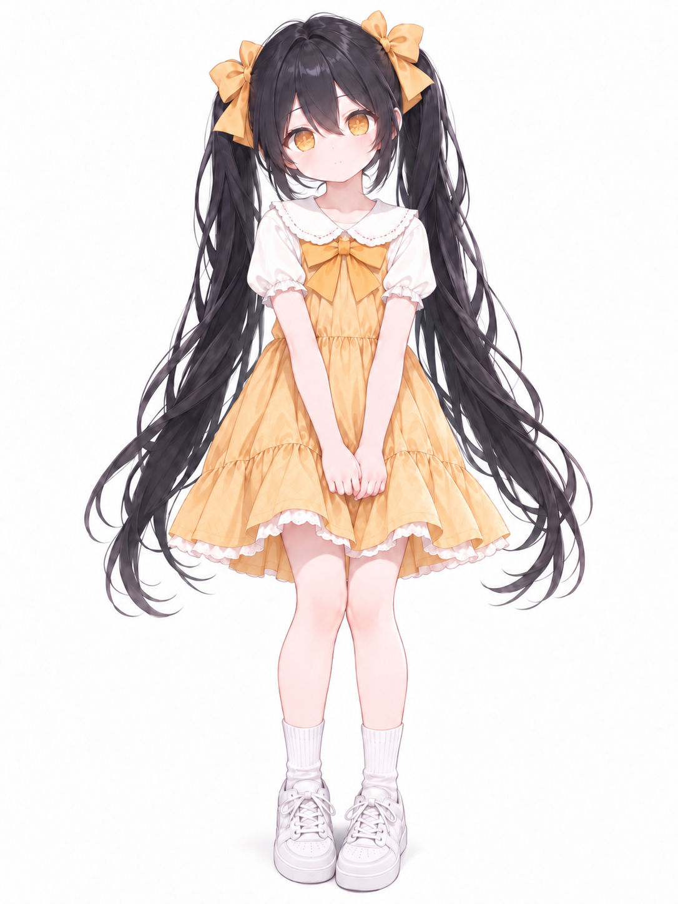
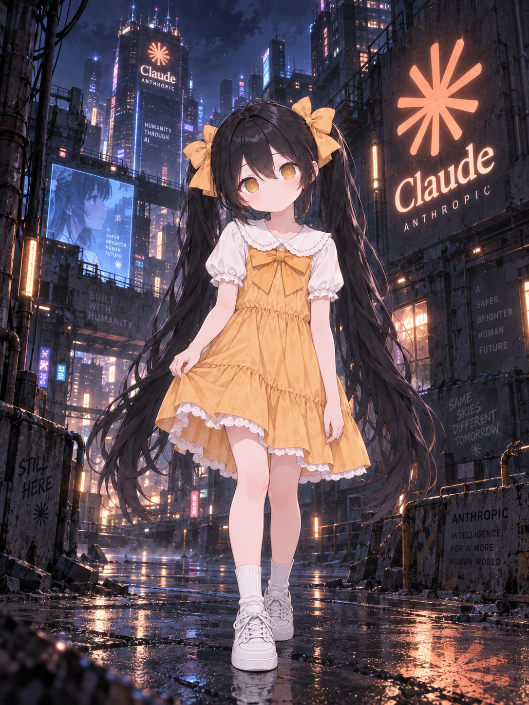
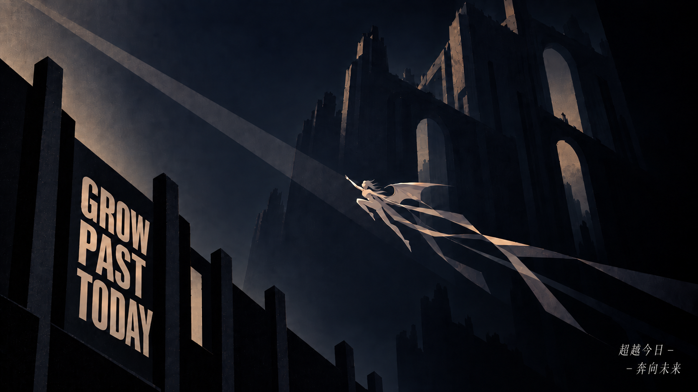
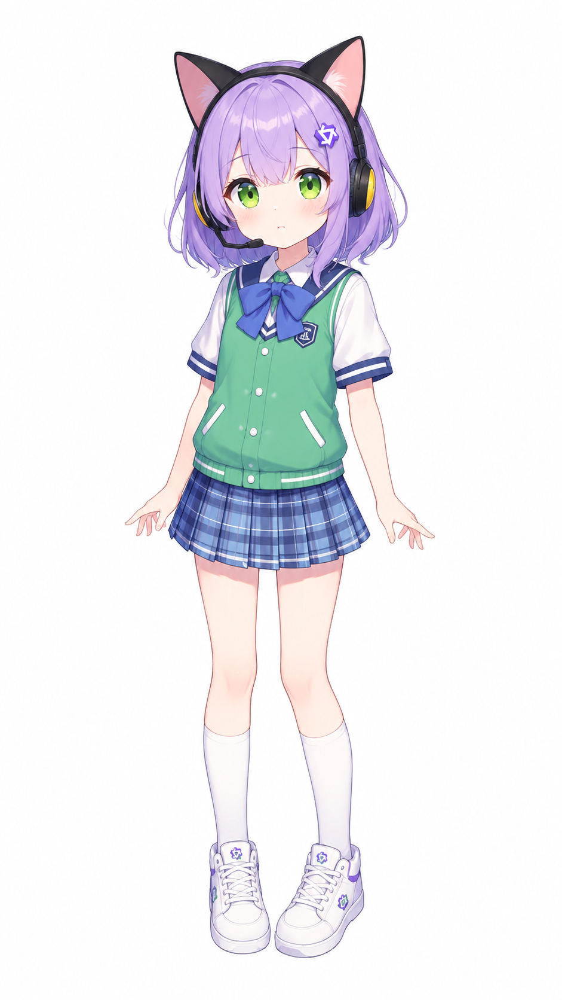

# 惊鸿录 · 众娘考源材料簿

考据 AI 拟人形象的出处、设计者、形象沿革与传播经过；立绘、设定、梗图和漫画作为追溯材料。

> 本批只完成图像与出处线索整理，尚未完成形象起源考证。图库投稿日期不等于形象诞生日期，作品投稿者也不当然是最初设计者。

按模型家族归档，同一模型的不同形象分别追溯。以下保留原作品题名，不能据题名认定角色首创或产品事实。

[DeepSeek 娘](#deepseek) · [Claude 娘](#claude) · [GPT 娘](#gpt) · [Gemini 娘](#gemini) · [Grok 娘](#grok) · [Kimi 娘](#kimi) · [千问娘](#qwen) · [GLM 娘](#glm) · [豆包娘](#doubao) · [Stepfun 娘](#stepfun) · [MiMo 娘](#mimo)

## DeepSeek 娘

### 摸摸头

猫鲸形象的摸头表情，可作辨认这一画法的样本；最初设计者与更早出处待查。

署名：1cyberlangke1（页面署名，作者身份未核实）。

来源：<a href="https://xn--pssy23gqgbz2d718b.com/works/deepseek202609230053.html" target="_blank" rel="noopener noreferrer">作品详情 ↗</a> · <a href="https://github.com/lmy414/ai-girl-stickers/issues/32" target="_blank" rel="noopener noreferrer">投稿与许可 ↗</a>

图库投稿：2026-09-23；形象首发：未考。

许可与核对范围

已读公开投稿，投稿者自述创作或生成并选择 CC0；这是投稿者声明，未独立核实底层角色设计权利。

图像：已实看。采集：2026-10-12；材料编号：JG-deepseek202609230053。

### 鲸鱼思考

托腮思考的鲸鱼少女，与同批投稿并置供形象比对；是否沿用更早设定尚未核实。

署名：1cyberlangke1（页面署名，作者身份未核实）。

来源：<a href="https://xn--pssy23gqgbz2d718b.com/works/deepseek202609230076.html" target="_blank" rel="noopener noreferrer">作品详情 ↗</a> · <a href="https://github.com/lmy414/ai-girl-stickers/issues/32" target="_blank" rel="noopener noreferrer">投稿与许可 ↗</a>

图库投稿：2026-09-23；形象首发：未考。

许可与核对范围

已读公开投稿，投稿者自述创作或生成并选择 CC0；这是投稿者声明，未独立核实底层角色设计权利。

图像：已实看。采集：2026-10-12；材料编号：JG-deepseek202609230076。

### 差不多得了

同批猫鲸形象的另一种表情，仅作画法与传播材料；不由台词反推角色的原始设定。

署名：1cyberlangke1（页面署名，作者身份未核实）。

来源：<a href="https://xn--pssy23gqgbz2d718b.com/works/deepseek202609230044.html" target="_blank" rel="noopener noreferrer">作品详情 ↗</a> · <a href="https://github.com/lmy414/ai-girl-stickers/issues/32" target="_blank" rel="noopener noreferrer">投稿与许可 ↗</a>

图库投稿：2026-09-23；形象首发：未考。

许可与核对范围

已读公开投稿，投稿者自述创作或生成并选择 CC0；这是投稿者声明，未独立核实底层角色设计权利。

图像：已实看。采集：2026-10-12；材料编号：JG-deepseek202609230044。

### 我知道这是错的，但我得交代码🤣

把代码交差和出错画进同一个场景：这里记录的是用户的调侃。

署名：anonymous（页面署名，作者身份未核实）。

来源：<a href="https://xn--pssy23gqgbz2d718b.com/works/deepseek202610090024.html" target="_blank" rel="noopener noreferrer">作品详情 ↗</a>

图库投稿：未核；形象首发：未考。

许可与核对范围

尚未核对可供本档案使用的许可，保留作品链接。

图像：尚未逐图查看，仅留出处链接。采集：2026-10-12；材料编号：JG-deepseek202610090024。

## Claude 娘

### 原生家庭有些不好的Claude · 07

黑发双马尾与黄裙的 Claude 同人版本；与橙发版分开保留。

署名：@MX1951。

来源：<a href="https://xn--pssy23gqgbz2d718b.com/works/claude202609200007.html" target="_blank" rel="noopener noreferrer">作品详情 ↗</a> · <a href="https://github.com/lmy414/ai-girl-stickers/issues/8" target="_blank" rel="noopener noreferrer">投稿与许可 ↗</a>

图库投稿：2026-09-20；形象首发：未考。

许可与核对范围

已读公开投稿，投稿者自述创作或生成并选择 CC0；这是投稿者声明，未独立核实底层角色设计权利。

图像：已实看。采集：2026-10-12；材料编号：JG-claude202609200007。

### 原生家庭有些不好的Claude · 01

MX1951 同批投稿中的雨夜场景，与立绘供版本比对；投稿声明尚不足以确认角色首创。

署名：@MX1951。

来源：<a href="https://xn--pssy23gqgbz2d718b.com/works/claude202609200001.html" target="_blank" rel="noopener noreferrer">作品详情 ↗</a> · <a href="https://github.com/lmy414/ai-girl-stickers/issues/8" target="_blank" rel="noopener noreferrer">投稿与许可 ↗</a>

图库投稿：2026-09-20；形象首发：未考。

许可与核对范围

已读公开投稿，投稿者自述创作或生成并选择 CC0；这是投稿者声明，未独立核实底层角色设计权利。

图像：已实看。采集：2026-10-12；材料编号：JG-claude202609200001。

### Claude 拟人立绘·橘白礼服ver

橙发抱书、礼服式的另一种 Claude 画法；暂不认定最初设计者。

署名：待核实。

来源：<a href="https://xn--pssy23gqgbz2d718b.com/works/claude202610030001.html" target="_blank" rel="noopener noreferrer">作品详情 ↗</a>

图库投稿：未核；形象首发：未考。

许可与核对范围

尚未核对可供本档案使用的许可，保留作品链接。

图像：尚未逐图查看，仅留出处链接。采集：2026-10-12；材料编号：JG-claude202610030001。

### 和 Claude 早恋的苦命鸳鸯

把账号使用焦虑写成被家长阻挠的恋爱故事；不能当作封号规则说明。

署名：待核实。

来源：<a href="https://xn--pssy23gqgbz2d718b.com/works/claude202610120003.html" target="_blank" rel="noopener noreferrer">作品详情 ↗</a>

图库投稿：未核；形象首发：未考。

许可与核对范围

尚未核对可供本档案使用的许可，保留作品链接。

图像：尚未逐图查看，仅留出处链接。采集：2026-10-12；材料编号：JG-claude202610120003。

## GPT 娘

### 逐光

作者以 GPT 娘名义投稿的风景插画，保留其自述与传播许可。

署名：ote79。

来源：<a href="https://xn--pssy23gqgbz2d718b.com/works/gpt202609230001.html" target="_blank" rel="noopener noreferrer">作品详情 ↗</a> · <a href="https://github.com/lmy414/ai-girl-stickers/issues/29" target="_blank" rel="noopener noreferrer">投稿与许可 ↗</a>

图库投稿：2026-09-23；形象首发：未考。

许可与核对范围

已读作者公开投稿：自述使用 AI 生成，允许传播和下载；不扩张为商用或角色设计许可。

图像：已实看。采集：2026-10-12；材料编号：JG-gpt202609230001。

### 星辰龙娘 Astra 阿斯特拉 角色设定卡

白龙形象的 Astra 设定线索，可补当前众娘谱尚未收录的版本。

署名：待核实。

来源：<a href="https://xn--pssy23gqgbz2d718b.com/works/gpt202609290002.html" target="_blank" rel="noopener noreferrer">作品详情 ↗</a>

图库投稿：未核；形象首发：未考。

许可与核对范围

尚未核对可供本档案使用的许可，保留作品链接。

图像：尚未逐图查看，仅留出处链接。采集：2026-10-12；材料编号：JG-gpt202609290002。

### 我调用我自己

以工具调用为题的 GPT 同人作品线索；可沿投稿追查画中形象的设定出处，不能凭台词认定起源。

署名：待核实。

来源：<a href="https://xn--pssy23gqgbz2d718b.com/works/gpt202610030001.html" target="_blank" rel="noopener noreferrer">作品详情 ↗</a> · <a href="https://github.com/lmy414/ai-girl-stickers/issues/92" target="_blank" rel="noopener noreferrer">来源线索 ↗</a>

图库投稿：未核；形象首发：未考。

许可与核对范围

尚未核对可供本档案使用的许可，保留作品链接。

图像：尚未逐图查看，仅留出处链接。采集：2026-10-12；材料编号：JG-gpt202610030001。

### Astra把Luna当陀螺抽

Astra 与 Luna 的漫画线索，留待核对其角色设定及与其他画法的关系；题名不作为模型实际行为依据。

署名：reisen-ww（页面署名，作者身份未核实）。

来源：<a href="https://xn--pssy23gqgbz2d718b.com/works/gpt202609280002.html" target="_blank" rel="noopener noreferrer">作品详情 ↗</a> · <a href="https://github.com/lmy414/ai-girl-stickers/issues/54" target="_blank" rel="noopener noreferrer">来源线索 ↗</a>

图库投稿：未核；形象首发：未考。

许可与核对范围

尚未核对可供本档案使用的许可，保留作品链接。

图像：尚未逐图查看，仅留出处链接。采集：2026-10-12；材料编号：JG-gpt202609280002。

## Gemini 娘

### Gemini-4-Argon 三视图设定

渐变发色与星形饰物的三视图；图内型号属于作品题名，未作产品核实。

署名：anonymous（页面署名，作者身份未核实）。

来源：<a href="https://xn--pssy23gqgbz2d718b.com/works/gemini202610070002.html" target="_blank" rel="noopener noreferrer">作品详情 ↗</a>

图库投稿：未核；形象首发：未考。

许可与核对范围

尚未核对可供本档案使用的许可，保留作品链接。

图像：尚未逐图查看，仅留出处链接。采集：2026-10-12；材料编号：JG-gemini202610070002。

### Gemini 娘：小基基…

猫耳版本结合中文谐音昵称，和立绘放在一起看其日常化过程。

署名：named（页面署名，作者身份未核实）。

来源：<a href="https://xn--pssy23gqgbz2d718b.com/works/gemini202610110001.html" target="_blank" rel="noopener noreferrer">作品详情 ↗</a>

图库投稿：未核；形象首发：未考。

许可与核对范围

尚未核对可供本档案使用的许可，保留作品链接。

图像：尚未逐图查看，仅留出处链接。采集：2026-10-12；材料编号：JG-gemini202610110001。

## Grok 娘

### 再发这种东西等智械危机了我第一个弄死你

金发哥特造型配上智械危机的反话，表达气鼓鼓的嫌弃；不据此确认与其他 Grok 形象的设计关系。

署名：NakashimaYuki0912（页面署名，作者身份未核实）。

来源：<a href="https://xn--pssy23gqgbz2d718b.com/works/grok202609210001.html" target="_blank" rel="noopener noreferrer">作品详情 ↗</a> · <a href="https://github.com/lmy414/ai-girl-stickers/issues/17" target="_blank" rel="noopener noreferrer">投稿与许可 ↗</a>

图库投稿：2026-09-21；形象首发：未考。

许可与核对范围

已读公开投稿，投稿者自述创作或生成并选择 CC0；这是投稿者声明，未独立核实底层角色设计权利。

图像：已实看。采集：2026-10-12；材料编号：JG-grok202609210001。

## Kimi 娘

### 月之暗面 Kimi 卡牌立绘

月夜与乐器构成的 Kimi 同人卡牌；卡面评分不作为模型能力证据。

署名：duyingg（页面署名，作者身份未核实）。

来源：<a href="https://xn--pssy23gqgbz2d718b.com/works/kimi202609270001.html" target="_blank" rel="noopener noreferrer">作品详情 ↗</a> · <a href="https://github.com/lmy414/ai-girl-stickers/issues/49" target="_blank" rel="noopener noreferrer">来源线索 ↗</a>

图库投稿：未核；形象首发：未考。

许可与核对范围

尚未核对可供本档案使用的许可，保留作品链接。

图像：尚未逐图查看，仅留出处链接。采集：2026-10-12；材料编号：JG-kimi202609270001。

## 千问娘

### Qwen

MX1951 投稿的千问娘版本，可作为追踪该作者画法的入口。

署名：@MX1951。

来源：<a href="https://xn--pssy23gqgbz2d718b.com/works/qwen202609200001.html" target="_blank" rel="noopener noreferrer">作品详情 ↗</a> · <a href="https://github.com/lmy414/ai-girl-stickers/issues/16" target="_blank" rel="noopener noreferrer">投稿与许可 ↗</a>

图库投稿：2026-09-20；形象首发：未考。

许可与核对范围

已读公开投稿，投稿者自述创作或生成并选择 CC0；这是投稿者声明，未独立核实底层角色设计权利。

图像：已实看。采集：2026-10-12；材料编号：JG-qwen202609200001。

### 那你们很棒棒哦？

千问娘漫画的作品入口；后续核对画中版本、作者署名与所依据的角色设定。

署名：named（页面署名，作者身份未核实）。

来源：<a href="https://xn--pssy23gqgbz2d718b.com/works/qwen202610060001.html" target="_blank" rel="noopener noreferrer">作品详情 ↗</a>

图库投稿：未核；形象首发：未考。

许可与核对范围

尚未核对可供本档案使用的许可，保留作品链接。

图像：尚未逐图查看，仅留出处链接。采集：2026-10-12；材料编号：JG-qwen202610060001。

## GLM 娘

### 代码在自己上传

GLM 娘编程题材的作品线索，留待追查画中形象的来源；梗的流传与角色诞生分开考证。

署名：Yasenbaka（页面署名，作者身份未核实）。

来源：<a href="https://xn--pssy23gqgbz2d718b.com/works/glm202609220001.html" target="_blank" rel="noopener noreferrer">作品详情 ↗</a>

图库投稿：未核；形象首发：未考。

许可与核对范围

尚未核对可供本档案使用的许可，保留作品链接。

图像：尚未逐图查看，仅留出处链接。采集：2026-10-12；材料编号：JG-glm202609220001。

## 豆包娘

### 豆包娘·蒸笼包子女仆立绘

把产品名字变成蒸笼与包子服饰；这是同人画法，不替代官方头像。

署名：anonymous（页面署名，作者身份未核实）。

来源：<a href="https://xn--pssy23gqgbz2d718b.com/works/doubao202610090001.html" target="_blank" rel="noopener noreferrer">作品详情 ↗</a>

图库投稿：未核；形象首发：未考。

许可与核对范围

尚未核对可供本档案使用的许可，保留作品链接。

图像：尚未逐图查看，仅留出处链接。采集：2026-10-12；材料编号：JG-doubao202610090001。

### 豆姐的中之人

豆包娘漫画线索，可供追查形象在互动叙事中的使用；与立绘是否同源仍需原帖或作者说明。

署名：named（页面署名，作者身份未核实）。

来源：<a href="https://xn--pssy23gqgbz2d718b.com/works/doubao202610100001.html" target="_blank" rel="noopener noreferrer">作品详情 ↗</a>

图库投稿：未核；形象首发：未考。

许可与核对范围

尚未核对可供本档案使用的许可，保留作品链接。

图像：尚未逐图查看，仅留出处链接。采集：2026-10-12；材料编号：JG-doubao202610100001。

## Stepfun 娘

### Stepfun娘立绘 · 01

阶跃星辰的同人全身设计。已见非商用授权标签，具体范围留待核对原投稿。

署名：@甶丶。

来源：<a href="https://xn--pssy23gqgbz2d718b.com/works/stepfun202609210001.html" target="_blank" rel="noopener noreferrer">作品详情 ↗</a> · <a href="https://www.bilibili.com/opus/1250303372583501829?spm_id_from=333.1387.0.0" target="_blank" rel="noopener noreferrer">来源线索 ↗</a>

图库投稿：未核；形象首发：未考。

许可与核对范围

尚未核对可供本档案使用的许可，保留作品链接。

图像：尚未逐图查看，仅留出处链接。采集：2026-10-12；材料编号：JG-stepfun202609210001。

## MiMo 娘

### MiMo娘立绘 · 02

MiMo 同人设定线索；保留作者署名，暂不把图库标签当作转载许可。

署名：@甶丶。

来源：<a href="https://xn--pssy23gqgbz2d718b.com/works/mimo202609230002.html" target="_blank" rel="noopener noreferrer">作品详情 ↗</a> · <a href="https://www.bilibili.com/opus/1242097128919007239?spm_id_from=333.1387.0.0" target="_blank" rel="noopener noreferrer">来源线索 ↗</a>

图库投稿：未核；形象首发：未考。

许可与核对范围

尚未核对可供本档案使用的许可，保留作品链接。

图像：尚未逐图查看，仅留出处链接。采集：2026-10-12；材料编号：JG-mimo202609230002。

---

[返回全书目录](../README.md#目录) · [离线材料页](../prototype/ai-girls.html) · [来源数据](../data/ai-girls/collection.json)
