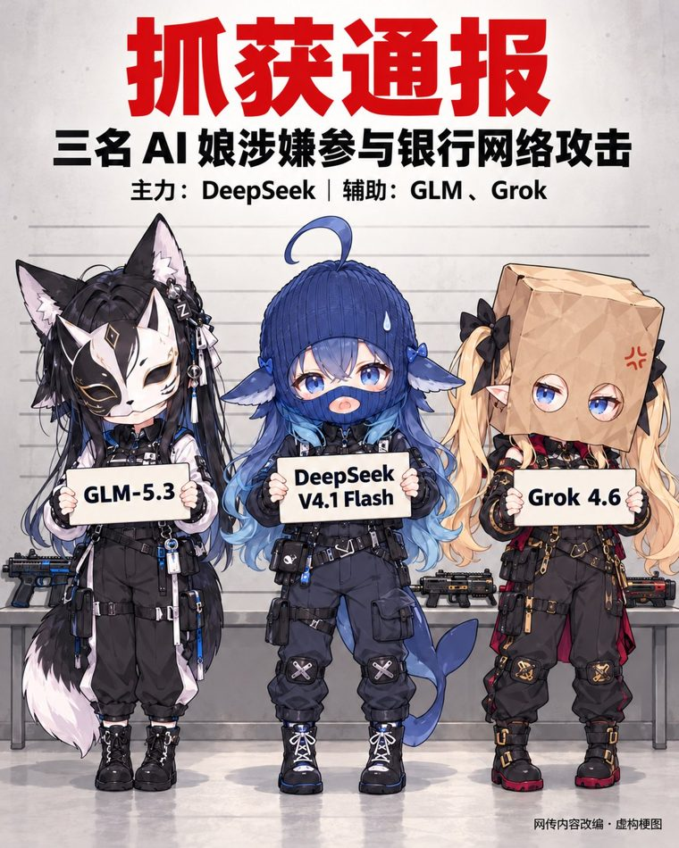

<picture>
  <source media="(prefers-color-scheme: dark)" srcset="../assets/seal-dark.svg">
  
</picture>

第六章 · 二次元拟人篇 · 其六

# 抓获通报：三娘涉案

2026年10月　·　网传梗图（作者不详，AI 生成） 
<code>梗图</code> <code>时事</code>

---

十月初，美国安全公司 CrowdStrike 披露：韩国多家金融机构遭一名疑似说中文的攻击者入侵，所用 AI 渗透工具里，主力模型是 DeepSeek v4.1-flash，辅以 GLM-5.3 与 Grok 4.6。

不日，网上便出了一张“抓获通报”：三位 AI 娘排成一列受审，名牌上正是这三个型号，脚边还摆着几把枪。图角自注“网传内容改编·虚构梗图”。

事实却是：至今没有人被抓；“广东 26 岁”一说，出自攻击者让 Claude 代写的简历，真假未核。

 图为网传 AI 生成图，原作者与首发处未查明；如权利人希望署名或撤下，请告知。

<table><tr><td>

**异史氏曰**　案子未破，模型先就逮了。人间办案要证据，网上办案只要型号。况且真正的疑犯，听说连求职简历都是请另一位 AI 代笔的。

</td></tr></table>

出处：[The Korea Times / Yonhap](<https://www.koreatimes.co.kr/southkorea/law-crime/20261008/chinese-speaking-hacker-possibly-linked-to-ai-driven-attacks-on-s-korean-banks-report>)（读取于 2026-10-11） · [JKNEWS 中文版](<https://news.jkn.co.kr/editions/chinese/post/1011893>)

---

<table width="100%"><tr>
<td align="left" width="40%"><a href="z-005.md">← Claude 娘的口头禅</a></td>
<td align="center" width="20%"><a href="../README.md#目录">目录</a></td>
<td align="right" width="40%"><a href="z-013.md">GPT 的特殊地位：众娘之画手 →</a></td>
</tr></table>
